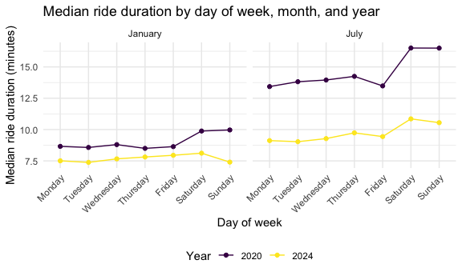
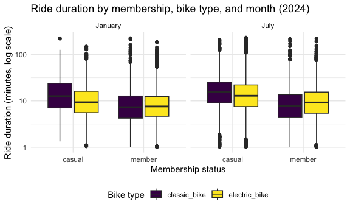

p8105_hw3_sr4354
================
sr4354
2026-10-18

## Problem 2

importing data

``` r
nhanes_covar = 
  read_csv("data/nhanes_covar.csv", skip = 4) |> 
  janitor::clean_names()

nhanes_accel = 
  read_csv("data/nhanes_accel.csv") |> 
  janitor::clean_names()
```

``` r
nhanes_df = 
  nhanes_covar |> 
  drop_na() |> 
  filter(age >= 21) |> 
  mutate(
    sex = factor(sex, levels = c(1, 2), labels = c("male", "female")),
    education = factor(
      education,
      levels = c(1, 2, 3),
      labels = c("Less than high school", "High school equivalent", "More than high school")
    )
  ) |> 
  inner_join(nhanes_accel, by = "seqn")
```

``` r
dim(nhanes_df)
```

    ## [1]  228 1445

## education by sex

``` r
nhanes_df |> 
  count(education, sex) |> 
  pivot_wider(names_from = sex, values_from = n) |> 
  knitr::kable(
    col.names = c("Education", "Male", "Female"),
    caption = "Number of participants by education level and sex"
  )
```

| Education              | Male | Female |
|:-----------------------|-----:|-------:|
| Less than high school  |   27 |     28 |
| High school equivalent |   35 |     23 |
| More than high school  |   56 |     59 |

Number of participants by education level and sex

``` r
nhanes_df |> 
  ggplot(aes(x = education, y = age, fill = sex)) +
  geom_boxplot() +
  scale_x_discrete(labels = scales::label_wrap(15)) +
  labs(
    title = "Age distribution by education level and sex",
    x = "Education level",
    y = "Age (years)",
    fill = "Sex"
  )
```


Those with more than a high school education (115 of 228 participants)
form the largest education group. Men and women are nearly balanced in
the less than high school and more than high school categories, while
the high school equivalent group has more men (35) than women (23). The
more than high school education group has the lowest median age and the
less than high school education group has the highest median age. The
median ages are similar across men and women for the less than high
school (60 and 61) and more than high school groups (43.5 and 41), but
the median age for high school equivalent men is 53 while the median age
for high school equivalent women is 62. The boxes also heavily overlap.

## total activity by age

``` r
nhanes_df = 
  nhanes_df |> 
  mutate(
    total_activity = rowSums(across(-c(seqn, sex, age, bmi, education)))
  )

nhanes_df |> 
  ggplot(aes(x = age, y = total_activity, color = sex)) +
  geom_point(alpha = .5) +
  geom_smooth(se = FALSE) +
  facet_wrap(~education) +
  labs(
    title = "Total daily activity by age, sex, and education level",
    x = "Age (years)",
    y = "Total activity (MIMS, summed over 24 hours)",
    color = "Sex"
  )
```


Across the three education groups, total daily activity generally
decreases with age for both men and women. Women tend to have higher
activity levels than men in some age groups, particularly among those
with a high school education or more than high school education. The
lines for men and women are close together, and in the less than high
school education group, the lines intersect. Each panel contains several
outliers which could reflect individual differences or even measurement
errors.

### 24-hour activity

``` r
nhanes_long_df = 
  nhanes_df |> 
  pivot_longer(
    cols = -c(seqn, sex, age, bmi, education, total_activity),
    names_to = "minute",
    values_to = "mims"
  ) |> 
  mutate(minute = parse_number(minute))

nhanes_long_df |> 
  ggplot(aes(x = minute, y = mims, color = sex)) +
  geom_line(aes(group = seqn), alpha = .1) +
  geom_smooth(se = FALSE) +
  facet_wrap(~education, ncol = 3) +
  scale_x_continuous(
    breaks = seq(0, 1440, 360),
    labels = c("0:00", "6:00", "12:00", "18:00", "24:00")
  ) +
  labs(
    title = "24-hour activity profiles by education level and sex",
    x = "Time of day (hours)",
    y = "Activity (MIMS)",
    color = "Sex"
  ) +
  theme(legend.position = "bottom")
```


Across the three education levels, activity is lowest overnight and in
the early morning (between midnight and 6am) before rising after 6am and
peaking in the late morning to early afternoon, around 10am to 1pm. Men
and women show very similar daily patterns, with only small differences
in the height of the curves and little difference in the timing of peak
activity. Across all three education levels, the overall daily shape is
consistent, although the group with more than high school education
shows greater variability and more extreme activity spikes.

## Problem 3

``` r
citi_df = 
  list.files("data", pattern = "Citi\\.csv$", full.names = TRUE) |> 
  read_csv(id = "file", show_col_types = FALSE) |> 
  janitor::clean_names() |> 
  mutate(
    file = str_remove(basename(file), " Citi\\.csv"),
    month = word(file, 1),
    year = parse_number(file),
    month = factor(month, levels = c("Jan", "July"), labels = c("January", "July")),
    year = factor(year),
    weekdays = factor(
      weekdays,
      levels = c("Monday", "Tuesday", "Wednesday", "Thursday", "Friday", "Saturday", "Sunday")
    ),
    rideable_type = factor(rideable_type),
    member_casual = factor(member_casual, levels = c("casual", "member"))
  ) |> 
  select(-file)
```

The dataset contains 99485 rides, a 1% sample of rides under 4 hours in
January and July of 2020 and 2024. Variables are ride ID, bike type, day
of week, ride duration (minutes), start and end station names, and
membership status, plus year and month derived from the file names. The
only missing data are in station names (43 start and 207 end stations)

### rides by year, month, and membership

``` r
citi_df |> 
  count(year, month, member_casual) |> 
  pivot_wider(names_from = member_casual, values_from = n) |> 
  mutate(total = casual + member) |> 
  knitr::kable(
    col.names = c("Year", "Month", "Casual", "Member", "Total"),
    caption = "Number of rides by year, month, and rider type"
  )
```

| Year | Month   | Casual | Member | Total |
|:-----|:--------|-------:|-------:|------:|
| 2020 | January |    984 |  11436 | 12420 |
| 2020 | July    |   5637 |  15411 | 21048 |
| 2024 | January |   2108 |  16753 | 18861 |
| 2024 | July    |  10894 |  36262 | 47156 |

Number of rides by year, month, and rider type

Total rides increased from 2020 to 2024 in both months, from 12,420 to
18,861 in January and from 21,048 to 47,156 in July. July had more rides
than January in both years, with that gap widening in 2024. Members took
most of the rides in every year and month (about 73% to 92%), but casual
riders were higher in July (about 27% in 2020 and 23% in 2024) than in
January (about 8% and 11%), suggesting casual use is driven by warm
weather.

``` r
citi_df |> 
  filter(year == 2024, month == "July") |> 
  count(start_station_name, sort = TRUE) |> 
  slice_head(n = 5) |> 
  knitr::kable(
    col.names = c("Start station", "Number of rides"),
    caption = "Five most popular starting stations, July 2024"
  )
```

| Start station            | Number of rides |
|:-------------------------|----------------:|
| Pier 61 at Chelsea Piers |             163 |
| University Pl & E 14 St  |             155 |
| W 21 St & 6 Ave          |             152 |
| West St & Chambers St    |             150 |
| W 31 St & 7 Ave          |             146 |

Five most popular starting stations, July 2024

The most popular starting station in July 2024 was Pier 61 at Chelsea
Piers (163 rides), followed by University Pl & E 14 St (155) and W 21 St
& 6 Ave (152). The top five stations are close in ride counts, ranging
from 146 to 163, and most are in Manhattan (specifically Chelsea, the
West Side, or near Union Square.)

``` r
citi_df |> 
  group_by(year, month, weekdays) |> 
  summarize(median_duration = median(duration), .groups = "drop") |> 
  ggplot(aes(x = weekdays, y = median_duration, color = year, group = year)) +
  geom_point() +
  geom_line() +
  facet_wrap(~month) +
  viridis::scale_color_viridis(name = "Year", discrete = TRUE) +
  labs(
    title = "Median ride duration by day of week, month, and year",
    x = "Day of week",
    y = "Median ride duration (minutes)"
  ) +
  theme_minimal() +
  theme(legend.position = "bottom", axis.text.x = element_text(angle = 45, hjust = 1))
```


Median ride durations tend to be longest on weekends, especially
Saturdays and Sundays. Rides are generally longer in July than in
January, with the biggest difference seen in 2020. Overall, median ride
durations were consistently higher in 2020 than in 2024 across both
months and all days of the week. In 2024, ride times stayed fairly
steady throughout the week, with a slight increase on Saturdays,
especially in July.

``` r
citi_df |> 
  filter(year == "2024") |> 
  ggplot(aes(x = member_casual, y = duration, fill = rideable_type)) +
  geom_boxplot() +
  facet_wrap(~month) +
  scale_y_log10() +
  viridis::scale_fill_viridis(name = "Bike type", discrete = TRUE) +
  labs(
    title = "Ride duration by membership, bike type, and month (2024)",
    x = "Membership status",
    y = "Ride duration (minutes, log scale)"
  ) +
  theme_minimal() +
  theme(legend.position = "bottom")
```



In both January and July, casual riders generally have longer ride
durations than members, especially when using classic bikes. Electric
bike rides tend to have similar median durations for casual riders and
members, with casual riders taking slightly longer rides. Ride durations
are generally longer in July than in January for both membership types
and bike types. There are also several unusually long rides in each
group, shown by the dots above the box plots.
