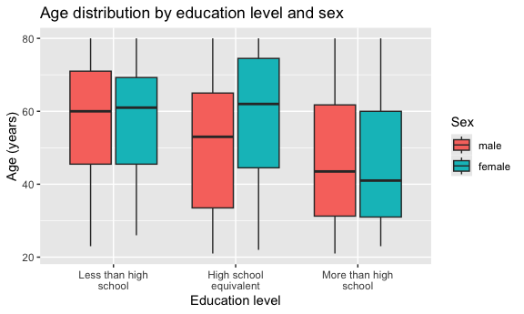
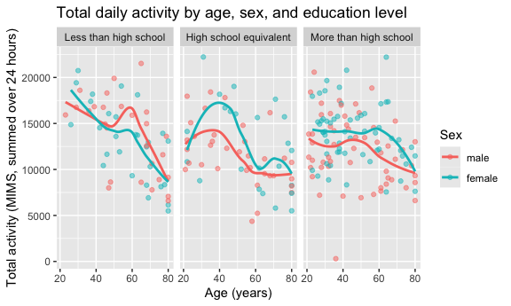
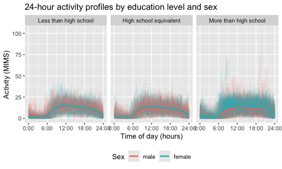

p8105_hw3_sr4354
================
sr4354
2026-10-18

## Problem 2

importing data

``` r
nhanes_covar = 
  read_csv("data/nhanes_covar.csv", skip = 4) |> 
  janitor::clean_names()

nhanes_accel = 
  read_csv("data/nhanes_accel.csv") |> 
  janitor::clean_names()
```

``` r
nhanes_df = 
  nhanes_covar |> 
  drop_na() |> 
  filter(age >= 21) |> 
  mutate(
    sex = factor(sex, levels = c(1, 2), labels = c("male", "female")),
    education = factor(
      education,
      levels = c(1, 2, 3),
      labels = c("Less than high school", "High school equivalent", "More than high school")
    )
  ) |> 
  inner_join(nhanes_accel, by = "seqn")
```

``` r
dim(nhanes_df)
```

    ## [1]  228 1445

## education by sex

``` r
nhanes_df |> 
  count(education, sex) |> 
  pivot_wider(names_from = sex, values_from = n) |> 
  knitr::kable(
    col.names = c("Education", "Male", "Female"),
    caption = "Number of participants by education level and sex"
  )
```

| Education              | Male | Female |
|:-----------------------|-----:|-------:|
| Less than high school  |   27 |     28 |
| High school equivalent |   35 |     23 |
| More than high school  |   56 |     59 |

Number of participants by education level and sex

``` r
nhanes_df |> 
  ggplot(aes(x = education, y = age, fill = sex)) +
  geom_boxplot() +
  scale_x_discrete(labels = scales::label_wrap(15)) +
  labs(
    title = "Age distribution by education level and sex",
    x = "Education level",
    y = "Age (years)",
    fill = "Sex"
  )
```



Those with more than a high school education (115 of 228 participants)
form the largest education group. Men and women are nearly balanced in
the less than high school and more than high school categories, while
the high school equivalent group has more men (35) than women (23). The
more than high school education group has the lowest median age and the
less than high school education group has the highest median age. The
median ages are similar across men and women for the less than high
school (60 and 61) and more than high school groups (43.5 and 41), but
the median age for high school equivalent men is 53 while the median age
for high school equivalent women is 62. The boxes also heavily overlap.

## total activity by age

``` r
nhanes_df = 
  nhanes_df |> 
  mutate(
    total_activity = rowSums(across(-c(seqn, sex, age, bmi, education)))
  )

nhanes_df |> 
  ggplot(aes(x = age, y = total_activity, color = sex)) +
  geom_point(alpha = .5) +
  geom_smooth(se = FALSE) +
  facet_wrap(~education) +
  labs(
    title = "Total daily activity by age, sex, and education level",
    x = "Age (years)",
    y = "Total activity (MIMS, summed over 24 hours)",
    color = "Sex"
  )
```


Across the three education groups, total daily activity generally
decreases with age for both men and women. Women tend to have higher
activity levels than men in some age groups, particularly among those
with a high school education or more than high school education. The
lines for men and women are close together, and in the less than high
school education group, the lines intersect. Each panel contains several
outliers which could reflect individual differences or even measurement
errors.

### 24-hour activity

``` r
nhanes_long_df = 
  nhanes_df |> 
  pivot_longer(
    cols = -c(seqn, sex, age, bmi, education, total_activity),
    names_to = "minute",
    values_to = "mims"
  ) |> 
  mutate(minute = parse_number(minute))

nhanes_long_df |> 
  ggplot(aes(x = minute, y = mims, color = sex)) +
  geom_line(aes(group = seqn), alpha = .1) +
  geom_smooth(se = FALSE) +
  facet_wrap(~education, ncol = 3) +
  scale_x_continuous(
    breaks = seq(0, 1440, 360),
    labels = c("0:00", "6:00", "12:00", "18:00", "24:00")
  ) +
  labs(
    title = "24-hour activity profiles by education level and sex",
    x = "Time of day (hours)",
    y = "Activity (MIMS)",
    color = "Sex"
  ) +
  theme(legend.position = "bottom")
```


Across the three education levels, activity is lowest overnight and in
the early morning (between midnight and 6am) before rising after 6am and
peaking in the late morning to early afternoon, around 10am to 1pm. Men
and women show very similar daily patterns, with only small differences
in the height of the curves and little difference in the timing of peak
activity. Across all three education levels, the overall daily shape is
consistent, although the group with more than high school education
shows greater variability and more extreme activity spikes.
